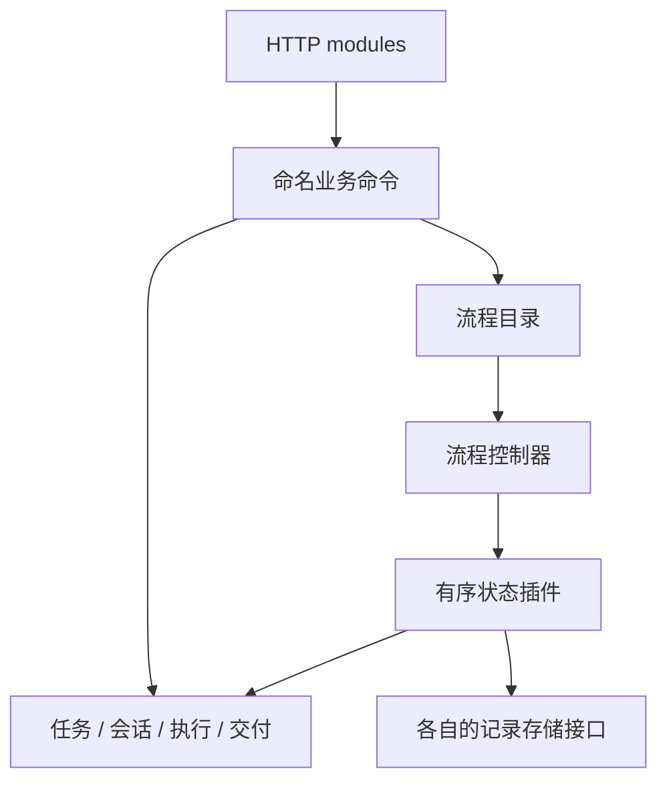

# M01：以状态插件组合流程步骤

更新：2026-11-18。按用户确认，插件是接口清晰、经 Deps 配置组合的模块；准备、执行、事实审核、人工验收、完成等所有流程步骤统一为状态插件。本文取代前版并列的交付 checks、通用审核 Coordinator/Evaluator 方案。只有现有 health 工程，以下业务尚未实现。

## 简化后的结构

命令处理明确业务动作和事务，例如创建任务、认领执行、提交回复、记录验收结论；状态插件决定该步骤的进入条件、进入动作、完成条件。HTTP、存储、身份、推送仍是能力模块，不必伪装成流程步骤。内部辅助函数不单独配置。

默认流程：准备 → 执行 → 人工验收 → 完成；无需人工验收时省略人工验收步骤；需要事实审核时在执行与人工验收之间插入事实审核状态。无需额外“审核引擎”“检查策略列表”或每类审核再加一套 Coordinator。

flow 只处理定义、位置、EntryID/RoundID、推进、控制命令、有界续查和事务内可靠写入。步骤业务由 State 实现；flow 不直接读取验收表、匹配 manual/none 分支、调用 review.Service 或遍历交付 checks。权限、版本、执行代次、取消不等于停止等是固定公共约束，不能通过删除业务步骤关闭。

## 状态插件的统一契约

State 提供 Describe/CheckEnter/Enter/CheckComplete。Describe 给稳定 key、角色、版本及行为摘要；检查只读返回 allow/wait/reject、原因及证据；Enter 为本地幂等准备动作，可为空，也可创建当前证据对应的审核记录/outbox。Enter 可被重复调用以同步新证据，不另设可选 Reconcile。

验收状态自己负责审核记录、结论绑定、验收人规则和等待原因；事实审核状态自己决定需要哪些材料/来源。它们通过 Deps 读取任务/交付及自己的存储，不依赖命令或 flow。需要人/远端输入的步骤可提供命名的事务内写能力，命令/API 适配它；步骤本身不调用远端、不决定 Agent 如何工作。

流程变更不等于 API 自动生成：纯本地审核只增加状态实现和配置；需要新的人工输入时同时提供该步骤的命名动作/API。新增存储可能需迁移，但不修改 flow 或原业务步骤。首版只支持线性步骤及显式取消/退回/重开，不扩展为脚本或任意 DAG。

## 单体与原子性

一个进程、一个 SQL 事务边界，模块通过 PluginKit 装配。命令为事务/幂等 owner，runtime/command 复用机制，不提供全局服务定位。步骤/事实子操作沿用主体、父 CommandID 及同一事务，内层失败 rollback-only。

CreateTask 同事务创建基础事实/验收人策略并由 flow 初始化首轮/位置。SubmitReply 固定消息修订和交付后调用流程 Evaluate，进入审核或验收。业务审核未通过表示已提交但该步骤等待/拒绝，不删除交付；格式、权限、代次或依据不合法则拒绝提交。技术失败整体回滚。RecordVerdict/EndExecution 等同事务重查。

正常推进保留 RoundID；显式 Return/Reopen 新轮使旧轮候选和步骤结论不再当前。交付按任务＋轮次保存 current 引用，不要求 flow 回调 results 清空全局指针。旧记录继续可追溯。替换执行、撤回及新交付仍显式使相关证据组合失效。

关键操作保护任务协调行及证据版本；跨任务按稳定 ID 锁顺序。远端身份解析在事务外，步骤使用可信本地身份依据。S3/通知/远端审核通过 outbox 和补偿，跨任务影响异步重查；命令完成校验不信任过期投影。

## 版本与完成保护

FlowRef 绑定步骤顺序、实现规则版本及行为摘要。验收模式由步骤描述派生并随定义固化：默认含人工验收步骤则需要该步骤通过，否则不要求独立人工验收；不再设置一份可能与列表矛盾的 acceptanceMode 配置。PolicyRevision 保存验收人及职责分离，不决定是否跳过步骤。人工验收配置由该步骤校验，none 情况不能留下无归属的验收策略。

同版本变更行为拒绝，保留旧定义实现或明确拒绝不支持版本；不声称保存 YAML 即可运行旧代码。末状态只能在当前轮所有已经过的步骤针对当前证据仍通过、完成步骤本身通过、执行安全退出通过后到达。新交付不能沿用旧事实审核/验收结论；具体算法见[状态契约](task-flow-plugins.md)。

## 生命周期与分期

root 管 SQL/blob、流程目录和受管组件；目录发布定义后开放业务入口，步骤无独立后台。HTTP 管模块和长连接，worker 管消费者，通知发送管渠道资源；构造无 IO/goroutine。依赖全部经 Deps，不把多个职责藏入万能 Service。

第一阶段文本、默认步骤、薄界面与真实 Buddy；用新事实审核状态验证无需改原插件的扩展。第二阶段文件/任务树/提醒，第三阶段历史恢复/容量。根 base/config 继续只含真实 health 图，不预注册占位业务插件。

[插件接口](plugin-contracts.md)、[清单与依赖审查](plugin-inventory-review.md)、[开发清单](../todo.md)同步描述本方案；构造无环不等于业务正确。
