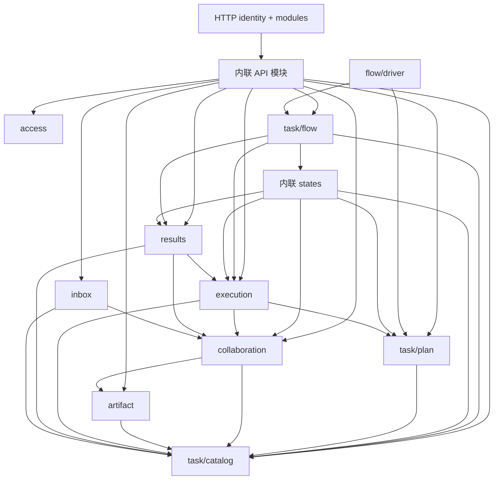

# 历史方案：D01/D02（已被 M01 取代）

2026-11-18：以下为历史讨论，不再作为实施或配置依据；其中“当前”“已同步”等措辞仅表达当时记录，不证明当前文件状态。当前权威见[模块化单体](architecture.md)。

# D01：聚合插件依赖复审与拆分建议

日期：2026-11-18。状态：D01 复审完成，用户已确认本拆分方案；D02 已将方案同步至文档及目标配置。本文保留复审时 core/work/flow/HTTP 的旧字段作为历史依据，当前配置以[插件契约](plugin-contracts.md)和 base 为准。业务 kind 仍未实现。

依据：[当前插件契约](plugin-contracts.md)、[base](../base.yaml)、[核心契约](core-contracts.md)。保留状态有序列表及默认内联配置，复用 PluginKit，不建设另一套容器。本文中的新 kind/能力名为设计建议，不是已注册实现。

## 1. 结论与取舍

撤销“八个顶层实例足以说明架构已经简化”的判断。core 和 work 的领域组合过宽，HTTP 的层次混合明显；flow 的控制与驱动需要分离。模块数量应服从不变量、事务边界、生命周期及变更原因。

比较三种办法：

| 办法 | 代价与结论 |
| --- | --- |
| 保留聚合插件，仅拆内部文件 | 可以整理代码，但构造器继续收集所有领域依赖，无法解决职责过宽；不推荐 |
| 每个对象和辅助步骤注册插件 | 边界清晰但容易把普通函数、记录端口和运行骨架全部配置化；不推荐 |
| 按内聚领域及生命周期拆插件，规则/辅助机制保留普通包 | 推荐；允许合理的公共依赖超阈值，默认叶子与 API 模块内联，不追求实例数最小 |

### 超过 5 的判定

按 Deps 声明字段计数，同一实例、同一 SQL 或同一 access 被多个字段引用仍逐项计数。列表字段算一个字段，但列表元素的插件必须分别审查，不能把业务服务塞进列表逃避检查。

正式写入共同依赖记作 P：`tx / requests / changes / audit / events / authz / confirmation`，共 7 项。它们分别负责事务、幂等、变更、审计、持久事件、授权与一次确认；不新增 command/default，不合并成万能 Commands 或持久化总接口。普通 runtime/command 显式组合 P。仅读取、保活及已读按实际语义使用子集。

因此“所有写插件最多 5 个 Deps”与当前显式写入契约不相容。超过 5 必须评审，但不能因此隐藏 P。下文每个超阈值项说明业务依赖及保留理由；计数基于建议字段清单，最终 typed Deps 变化须重审。

## 2. core：11 项依赖的去向

当前 core 同时拥有九类业务和两类后台循环，且用一个 store 汇总多个仓储。这不是一个内聚领域。

| 当前 Deps | 建议去向与理由 |
| --- | --- |
| store | 拆为 access、catalog、plan、collaboration、inbox 各自命名仓储接口；不继续保留 core.Repository |
| tx | 各正式写入方的 P；组合操作加入同一 SQL 事务 |
| requests | 各外部命令的 P；内部调用沿用父 CommandID |
| changes | 需要正式变更的领域使用 P；已读等不机械写需求修订 |
| audit | 各命令 P；拒绝审计仍由 runtime/command 回滚后追加 |
| events | 各领域仅注入 Writer；inbox 的事件读取单独声明 eventReader |
| cursors | 只留给 inbox 的可靠消费，不再进入任务/会话构造器 |
| definitions | catalog 创建任务校验不可变 FlowRef，不依赖 flow 实例 |
| policyStore | catalog 创建任务同事务初始化 Policy 的受限端口，不暴露 SetPolicy |
| materialRefs | 移出 core：collaboration 经 artifact 的引用能力校验/保留，不跨域直接写材料事实 |
| identity | access 和 catalog 需要；collaboration 可信主体来自入口，不额外查目录 |

建议拆为五个独立插件：

| kind | 内部普通模块 | 独立理由 |
| --- | --- | --- |
| access/default | authorization、confirmation | 同一安全决策链，确认精确消费服务于授权；内部构造避免两者互依赖，问题答复不放这里 |
| task/catalog | task、project | 任务约定与项目组织/成员事实；项目是任务可选归属，两者均无独立后台。保留两个仓储/接口及不同写入归属，不夹带计划算法 |
| task/plan | tree、dependencies、change-set | 跨节点原子操作、影响范围和环保护，有独立算法及事务边界 |
| collaboration/default | conversation、decision | 同一任务协作记录与待答问题；问题可独立创建，绑定不可变消息引用，不把答复当作授权。保留独立记录和规则，不承担任务/验收写入 |
| inbox/default | notification、reminder | 面向人的待处理提醒与收件箱，两者共同负责提醒生成和呈现；独立 owner 管消费与扫描，不承担原业务待办 |

catalog 中 task/project、collaboration 中 conversation/decision、inbox 中 notification/reminder 各保留普通子模块；构造清单中分别列仓储，不能以总 store 掩盖数量。未来若项目治理、决策工作流或外部投递产生独立变更需求，再拆对应插件，首版不预建。

## 3. work：15 项依赖的去向

| 当前 Deps | 建议去向与理由 |
| --- | --- |
| store | execution、results、artifact 各自仓储，不保留 work.Repository |
| tx/requests/changes/audit/events/authz/confirmation | 七项均保留在实际正式写入方，不另打包 |
| definitions | execution 读取执行阶段，results 校验验收模式；均是 SQL DefinitionReader，不回调 flow |
| tasks | execution、results、artifact 分别读取任务/依据/范围 |
| plan | execution 认领条件；正式完成仍由 flow 状态组合判断 |
| decisions | execution 检查阻塞问题；依赖 collaboration.Reader |
| replies | 仅 results 的 SubmitReply 需要，依赖 collaboration.ResultReplies |
| identity | execution 解析 Buddy/实例；results 解析验收职责分离的代理归属 |
| objects | 仅 artifact 需要；不进入执行/验收构造器 |

建议拆为三个独立插件：

- `execution/default`：分配、执行所有权、代次、保活、结束与停止。普通包实现认领及安全退出规则。
- `results/reply`：delivery 与 acceptance 两个普通子模块，分别保存提交与结论。共同围绕“当前结果证据组合”协调，保留两种事实、各自 API/仓储/版本；SyncCurrent 不等于通过，不自动完成任务。
- `artifact/default`：材料元数据、版本、字节存储与补偿；独立 owner 管理清理循环。

results 合并的依据是当前提交、评审和证据组合共同演进，且无不同验收实现的现时需求。未来出现独立会签、第三方评审或多个交付后端，再拆 acceptance/delivery；不为二者各有表就立即注册两个插件。

此时 collaboration 可正常依赖 artifact，results 依赖 collaboration 和 execution；artifact 不依赖 collaboration/results，不再需要 core 跨域写 materialRefs 的绕环方案。collaboration.PinRevision 通过 artifact.ReferenceKeeper 固定文件版本，仍加入同一事务。artifact 删除必须检查引用并保护并发。

## 4. flow：14 项依赖的去向

| 当前 Deps | 建议去向与理由 |
| --- | --- |
| states | 留在控制器，保持 []flow.State、默认内联 |
| store | 控制器的定义/位置仓储；等待扫描另用 PendingReader 小端口 |
| tx/requests/changes/audit/events/authz/confirmation | 控制器正式写入 P；events 仅 Writer |
| cursors | 移到 driver，控制器不管理消费进度 |
| tasks | 控制器校验身份、依据、预期版本 |
| plan | 移到 driver 的 ImpactReader；各状态按自身条件单独注入 plan.Reader |
| executions | 控制器分别声明 executionReader、executionControl：保护与取消隔离，不用可任意修改的执行 Service |
| results | 控制器只注入 resultControl：受权开新轮时清空当前交付/评审，历史保留 |

拆成：

- `task/flow`：控制器、不可变定义发布、位置与轮次、显式命令、有界自动推进。Open 只发布定义，没有消费/定时循环；保护与完成算法仍是普通包，不新增 helper 插件。
- `flow/driver`：可靠事件消费、影响定位、周期核对。一个实例注入已启用 flows 列表，不再为每个流程重复扫描全部事件；对每个目标按其持久 FlowRef 路由。

driver 的 Deps 为 `events / cursors / flows / impacts / pending`，共 5 项。impacts 为 plan.ImpactReader，pending 为 SQL flow.PendingReader；调用都携带可信入口建立的租户/任务范围受限 automation 主体。driver 不自授系统权限，最终写授权由控制器校验。按目标处理的幂等及分页进度要落库；部分失败不能跳过未处理目标再确认整条事件。

一个 driver 的消费确认只表示目标分发处理完成，不影响 inbox、客户端 feed 等消费者；消费驱动与 WS 仍独立。保留期外仍须周期核对等待/未初始化项，不能只依赖事件。

## 5. HTTP：21 项依赖的去向

HTTP 应只管理网络协议和模块生命周期。恢复已有 `identity / modules` 两字段的组合入口，普通路由包由内联 API 插件构造；这复用当前已实现 Module，不增加通用服务容器。

| 当前 Deps | 建议接收者 |
| --- | --- |
| identity | HTTP 统一建立可信身份 |
| tasks/projects/plan | api/tasks；各字段只依赖相应小接口 |
| conversations/decisions | api/collaboration |
| execution/delivery/acceptance/artifacts | api/work，四种能力分别注入，不交给 HTTP 根 |
| flows | api/flow；模块按 FlowRef 路由，无全局查找 |
| authz | api/access 管理入口、查询包、事件运维和授权 feed 分别显式注入 |
| confirmation | api/access |
| notifications | api/inbox |
| queries/revisions | api/query 内分别构造工作台、搜索和历史普通包 |
| audit | api/query 注入 auditReader；api/event-operations 注入 auditWriter，不能一个万能 audit 同时掩盖读写 |
| events | transport/task-events 注入 eventReader；api/event-operations 注入受限运维端口 |
| cursors | transport/task-events 连接游标；重放使用独立命名的 operations 端口，不开放任意 CursorStore |
| tx/requests | 仅 api/event-operations 的受权运维写入需要；业务路由由领域命令拥有事务 |

默认内联模块建议：

| kind | Deps 字段 | 数量 |
| --- | --- | --- |
| api/tasks | tasks、projects、plan | 3 |
| api/collaboration | conversations、decisions | 2 |
| api/work | execution、delivery、acceptance、artifacts | 4 |
| api/flow | flows | 1 |
| api/access | grants、confirmation | 2 |
| api/inbox | inbox | 1 |
| api/query | queries、revisions、auditReader、authz | 4 |
| api/event-operations | operations、tx、requests、auditWriter、authz | 5 |
| transport/task-events | events、cursors、tasks、authz | 4 |

api/query 内三个普通查询包不维护权威业务状态，恢复只产出方案。event-operations 的 operations 仅 ListFailures/RequestReplay 两个命名操作，不是万能 Execute；不注入任意业务事件写入能力。transport/task-events 内同时提供 HTTP changes 和 WS，复用同一授权 feed，避免再拆一个仅转发的 feed 插件。HTTP owner 管其 ModuleLifecycle/连接/循环；根不重复登记。

## 6. 拆分后的超阈值复审记录

下表完整列出建议的领域构造依赖；P 展开计 7 个。仓储采用消费者专用命名接口，不向消费者暴露 SQL 具体类型。

| 插件 | P 之外的 Deps | 总字段数 | 保留依据 |
| --- | --- | --- | --- |
| access/default | grantStore、confirmationStore、scopes、identity、tx、requests、changes、audit、events（本行不额外加 P） | 9 | 单一安全链；authz/confirmation 内部构造，显式注入命令机制，不形成自身插件引用；scopes 只读本地资源范围，不用 Service 容器 |
| task/catalog | taskStore、projectStore、definitions、policyStore、identity | 12 | 资源约定/归属管理；无事件读取或后台能力；初始 Policy 端口仅创建时使用 |
| task/plan | store、tasks、taskWriter | 10 | 同一次计划变更的读取与原子子任务创建；父命令一次确认 |
| collaboration/default | messageStore、decisionStore、tasks、artifacts、artifactRefs | 12 | 协作记录和待答问题；材料读取和保留分开命名，既不运行 Agent 也不决定完成 |
| inbox/default | notificationStore、reminderStore、tasks、decisions、eventReader、cursors（只用 P 的 tx/requests/events/authz 四项） | 10 | 同一提醒/收件箱生命周期；不是正式验收或任务写入。若增加正式偏好审计等依赖须重计 |
| execution/default | store、tasks、definitions、plan、decisions、identity | 13 | 都是执行认领/所有权安全条件；无消息正文、对象存储、评审或事件消费 |
| results/reply | submissionStore、reviewStore、tasks、definitions、executions、replies、identity | 14 | 当前结果和评审证据链；不拥有对象存储、执行调度或 flow 状态 |
| artifact/default | store、tasks、objects | 10 | 材料生命周期与补偿；不拥有会话、交付或评审 |
| task/flow | store、tasks、states、executionReader、executionControl、resultControl | 13 | 都服务于唯一状态写入及跨域原子控制命令；去掉消费、影响计算和定时扫描 |

这些数字并不声称比旧构造器更少：独立小接口会暴露此前聚合 store 和内部授权掩盖的依赖。拆分的收益是每个字段服务于同一个业务边界，且后台/协议/领域职责清晰。不能再按字段数把一次原子 SubmitReply 或受权 Return 拆成多个非原子步骤。公共依赖太多应复审共同机制是否真正必要，但本轮不改变 T04。

最终 completed 状态仍有 tasks/definitions/deliveries/acceptance/plan/decisions 共 6 项：分别证明依据、模式、结果、结论、子任务/依赖和阻塞输入，全部属于最终完成判断。保留一个状态及普通内部检查器，不再建隐藏这些依赖的万能 CompletionService；后续若支持可选检查器列表，须逐个评审其真实依赖。

## 7. 调整后的无环依赖

箭头表示构造依赖，省略各写插件的 P 和 SQL/blob/identity；不能据此省略真实 Deps。

access 只依赖 identity 和 SQL 本地范围查询端口，不依赖 catalog/plan 等业务 Service。catalog 读 SQL 已发布定义及初始 Policy，不依赖 flow/results。artifact 不依赖消息/结果，消除材料引用环。results 不依赖 flow；状态读取 results，results 不反向写状态。

状态继续默认内联：ready 读取 catalog/plan/collaboration，executing 再读取 execution/results，accepting 读取 results 的验收小接口，completed 组合最终证据。状态插件没有后台生命周期。

## 8. 生命周期与实施边界

- 根 resources：SQL → blob → 各 flow 定义发布；成功后启动 HTTP、flow driver、inbox 和 artifact 的受管组件。
- catalog/plan/collaboration/execution/results/access 无后台循环，构造时不做 IO；被真实入口引用即构建，不为了启用加入 components。
- inbox 拥有通知消费和期限扫描，artifact 拥有材料清理；driver 拥有流转消费与重查；HTTP 拥有长连接与内部模块。runtime/worker 仍为普通机制，不新增 event/worker 透传节点。
- 退出先取消入口和各组件，等待结束后逆序关闭资源。共享事务不因插件拆分改变，不能把远端身份读取或 S3 操作放进可重放 SQL 回调。

本次公共接口变化限于建议：拆掉 core/work 巨型提供者、分离 flow driver、恢复 HTTP Module 装配、材料引用回归 artifact 能力。受影响消费者为未来构造器、状态 Deps、root 生命周期清单、流程示例和设计检查。行为兼容继续遵守 C01—C18；尚无业务运行数据，不需要迁移部署中的业务实例。

D02 已同步契约、base/config、流程片段、loader 的 task/catalog 默认引用检查及开发任务归属；不注册空成功业务插件。实现阶段仍须按 typed Deps 和真实事务验证。
