# M05 实际默认依赖图

由当前 base.yaml 的已实现实例整理；25 个实例，含 M05 之后新增的 catalog、question-commands 与 mcp-api（见[请求输入与人工引导](m05-workflow.md#请求输入与人工引导)）。跨阶段的 52 节点规划不等于此运行图。字段与接口职责见 [M05](m05-workflow.md)。

```mermaid
flowchart TD
  n0["server<br/>server"]
  n1["http<br/>transport/http"]
  n2["health<br/>api/health"]
  n3["sql<br/>storage/sql"]
  n4["identity<br/>identity/local"]
  n5["access<br/>access/default"]
  n6["ready<br/>state/ready"]
  n7["flow<br/>flow/directory"]
  n8["flow-preparation<br/>task/flow"]
  n9["flow-standard<br/>task/flow"]
  n10["executing<br/>state/executing"]
  n11["accepting<br/>state/accepting"]
  n12["completed<br/>state/completed"]
  n13["command-runtime<br/>commands/runtime"]
  n14["security<br/>commands/security"]
  n15["catalog<br/>catalog/projects"]
  n16["workspace<br/>workspace/tasks"]
  n17["workspace-api<br/>api/workspace"]
  n18["workflow-query<br/>query/workflow"]
  n19["execution-commands<br/>commands/execution"]
  n20["result-commands<br/>commands/result"]
  n21["question-commands<br/>commands/question"]
  n22["flow-commands<br/>commands/flow"]
  n23["workflow-api<br/>api/workflow"]
  n24["mcp-api<br/>api/mcp"]
  n0 -->|resources| n3
  n0 -->|components| n1
  n1 -->|modules| n2
  n1 -->|modules| n17
  n1 -->|modules| n23
  n1 -->|modules| n24
  n4 -->|store| n3
  n5 -->|store| n3
  n5 -->|tasks| n3
  n7 -->|positions| n3
  n7 -->|flows| n8
  n7 -->|flows| n9
  n8 -->|definitions| n3
  n8 -->|positions| n3
  n8 -->|states| n6
  n9 -->|definitions| n3
  n9 -->|positions| n3
  n9 -->|executions| n3
  n9 -->|questions| n3
  n9 -->|states| n6
  n9 -->|states| n10
  n9 -->|states| n11
  n9 -->|states| n12
  n10 -->|results| n3
  n11 -->|results| n3
  n11 -->|reviews| n3
  n11 -->|members| n3
  n12 -->|results| n3
  n13 -->|transactions| n3
  n13 -->|requests| n3
  n13 -->|identity| n4
  n13 -->|authorization| n5
  n13 -->|audit| n3
  n13 -->|events| n3
  n14 -->|passwords| n3
  n14 -->|commands| n13
  n14 -->|transactions| n3
  n14 -->|principals| n3
  n14 -->|credentials| n3
  n14 -->|bootstrap| n3
  n14 -->|members| n3
  n14 -->|audit| n3
  n14 -->|events| n3
  n15 -->|transactions| n3
  n15 -->|identity| n4
  n15 -->|members| n3
  n15 -->|store| n3
  n15 -->|commands| n13
  n16 -->|catalog| n3
  n16 -->|members| n3
  n16 -->|participants| n3
  n16 -->|transactions| n3
  n16 -->|tasks| n3
  n16 -->|commits| n3
  n16 -->|flow| n7
  n16 -->|identity| n4
  n16 -->|authorization| n5
  n16 -->|commands| n13
  n16 -->|events| n3
  n16 -->|progress| n19
  n17 -->|commands| n16
  n17 -->|queries| n16
  n17 -->|changes| n16
  n17 -->|identity| n4
  n17 -->|security| n14
  n17 -->|catalog| n15
  n18 -->|questions| n3
  n18 -->|commits| n3
  n18 -->|transactions| n3
  n18 -->|tasks| n3
  n18 -->|flow| n7
  n18 -->|executions| n3
  n18 -->|results| n3
  n18 -->|reviews| n3
  n18 -->|identity| n4
  n18 -->|authorization| n5
  n19 -->|participants| n3
  n19 -->|principals| n3
  n19 -->|members| n3
  n19 -->|commands| n13
  n19 -->|tasks| n3
  n19 -->|flow| n7
  n19 -->|executions| n3
  n19 -->|snapshots| n18
  n19 -->|events| n3
  n20 -->|commands| n13
  n20 -->|tasks| n3
  n20 -->|flow| n7
  n20 -->|executions| n3
  n20 -->|results| n3
  n20 -->|commits| n3
  n20 -->|accepting| n11
  n20 -->|snapshots| n18
  n20 -->|events| n3
  n21 -->|commands| n13
  n21 -->|tasks| n3
  n21 -->|flow| n7
  n21 -->|commits| n3
  n21 -->|questions| n3
  n21 -->|progress| n19
  n21 -->|relations| n3
  n21 -->|snapshots| n18
  n21 -->|events| n3
  n22 -->|commands| n13
  n22 -->|tasks| n3
  n22 -->|flow| n7
  n22 -->|executions| n3
  n22 -->|snapshots| n18
  n22 -->|events| n3
  n23 -->|executions| n19
  n23 -->|results| n20
  n23 -->|controls| n22
  n23 -->|workflow| n18
  n23 -->|questions| n21
  n23 -->|security| n17
  n24 -->|tasks| n16
  n24 -->|comments| n16
  n24 -->|workflow| n18
  n24 -->|executions| n19
  n24 -->|results| n20
  n24 -->|questions| n21
  n24 -->|security| n17
```

全部引用存在，无循环，全部实例由 server 可达。SQL 提供多个内聚能力；指向同一 sql 不意味着消费者拥有全部写权限，方法集由 typed Deps 限定。

| 实例 | kind | 声明 Deps |
| --- | --- | --- |
| server | server | resources、components |
| http | transport/http | modules |
| health | api/health | 无 |
| sql | storage/sql | 无 |
| identity | identity/local | store |
| access | access/default | store、tasks |
| ready | state/ready | 无 |
| flow | flow/directory | positions、flows |
| flow-preparation | task/flow | definitions、positions、states |
| flow-standard | task/flow | definitions、positions、executions、questions、states |
| executing | state/executing | results |
| accepting | state/accepting | results、reviews、members |
| completed | state/completed | results |
| command-runtime | commands/runtime | transactions、requests、identity、authorization、audit、events |
| security | commands/security | passwords、commands、transactions、principals、credentials、bootstrap、members、audit、events |
| catalog | catalog/projects | transactions、identity、members、store、commands |
| workspace | workspace/tasks | catalog、members、participants、transactions、tasks、commits、flow、identity、authorization、commands、events、progress |
| workspace-api | api/workspace | commands、queries、changes、identity、security、catalog |
| workflow-query | query/workflow | questions、commits、transactions、tasks、flow、executions、results、reviews、identity、authorization |
| execution-commands | commands/execution | participants、principals、members、commands、tasks、flow、executions、snapshots、events |
| result-commands | commands/result | commands、tasks、flow、executions、results、commits、accepting、snapshots、events |
| question-commands | commands/question | commands、tasks、flow、commits、questions、progress、relations、snapshots、events |
| flow-commands | commands/flow | commands、tasks、flow、executions、snapshots、events |
| workflow-api | api/workflow | executions、results、controls、workflow、questions、security |
| mcp-api | api/mcp | tasks、comments、workflow、executions、results、questions、security |
