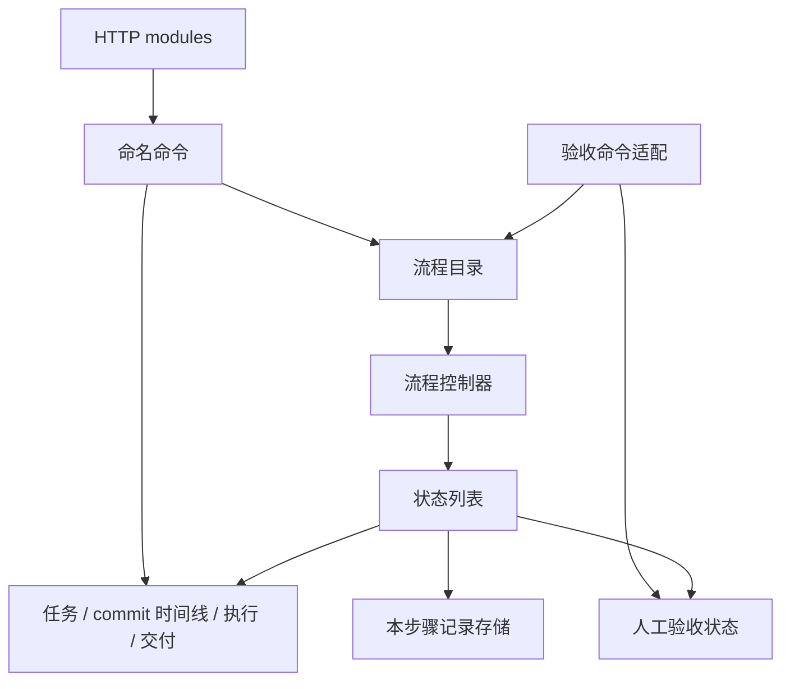

# 插件清单与依赖审查：流程步骤统一为 State

更新：2026-11-18。本文取代此前 52 节点方案中的通用审核/交付 checks 设计。任务业务未实现；完整表为跨阶段设计基线。M03 已注册 SQL/identity/access，实际接口/Deps 子集见 [M03 实现](m03-storage.md)，不能将未来字段当作当前构造参数。实例数量不是简化目标：默认仍为 52 个跨阶段候选，减少的是职责、依赖与并列的扩展机制。事实审核作为新增步骤示例，不默认装配。

## 本轮收敛

- results 只提供交付事实，不再提供 review.Coordinator/通用评审服务；人工验收记录和判断归 state/accepting。
- review-commands 改为薄 acceptance-commands，仅适配授权/事务和步骤的命名 RecordVerdict，不再实现另一套验收规则。
- 删除 delivery checks 列表；可定制的交付质量/事实审核改为提交后的状态步骤。登记前的格式、授权、代次和依据验证仍不可省略。
- flow 不直接依赖 delivery/review/decision，不清空全局结果指针；新 RoundID 自然隔离旧轮候选。任务语义由步骤检查，执行退出仍为固定安全保护。
- 不增加通用 Eligibility/CompletionCondition/ReviewEvaluator 框架；认领调用流程 CheckAction 重查相应状态，完成检查在完成状态，额外阶段审核用新 State。

[JSON 清单](plugin-dependencies.json)是静态审查数据，不是运行配置或第三层配置。[完整 Mermaid](plugin-dependencies.mmd)逐字段对应清单。第一阶段仅使用第一阶段候选，I→II 节点的后续字段需随实现裁剪，不能以图投影冒充 typed 构建。

## 插件职责、接口与 Deps

完整跨阶段目标图；实际 M03 子集见 [实现说明](m03-storage.md)。字段数量按声明计数，超过五项仍需逐项评审。

| ID / kind / 阶段 | 职责；提供接口 | Deps（字段:接口 → 提供者） | 数量 / owner |
| --- | --- | --- | --- |
| `sql` `storage/sql` I | GORM 多方言 SQL 连接、迁移及各领域独立仓储；本地默认 SQLite，不含业务判断 `lifecycle.Resource` `各消费者所需的领域 Store / Log / 只读能力` `unitofwork.Manager / record.Receipts / AuditWriter / EventLog` | 无 | 0 / root Resource |
| `identity` `identity/local` I | 使用仅查询摘要凭据的能力认证，目录查询由 SQL 提供 `identity.Authenticator.Authenticate` | `store:identity.CredentialLookup` → sql | 1 / 无后台 |
| `access` `access/default` I→II | 按有效租户成员、管理员、任务负责人和参与关系判断固定业务规则 `authorization.Authorizer.Check` | `store:authorization.Relations` → sql `tasks:task.Reader` → tasks | 2 / 无后台 |
| `tasks` `task/facts` I | 目标、负责人、依据、项目与验收人策略；不写轮次/阶段 `task.Reader.Get / List / GetPolicy` `task.Editor.Create / UpdateDetails / AssignOwner / SetPolicy` `project.Reader / Editor` | `tasks:task.Store` → sql `projects:project.Repository` → sql `policies:task.PolicyRepository` → sql | 3 / 无后台 |
| `commits` `commit/immutable` I | 不可变正文与引用；追加/精确读取/游标分页，不拥有阻塞问题或业务状态 `commit.Log.Append / Get / List` | `store:commit.Log` → sql | 1 / 无后台 |
| `execution` `execution/facts` I | 分配/认领/代次/保活/结束/停止事实与退出判断 `execution.Reader.GetCurrent / CheckExit` `execution.Editor.Assign / Open / Renew / End / RequestStop / AcknowledgeStop / Invalidate` | `store:execution.Repository` → sql | 1 / 无后台 |
| `results` `delivery/reply` I | 回复交付登记与按轮次的当前候选；不管理验收记录 `delivery.Reader.GetCurrent / GetSubmission` `delivery.Editor.Register / Withdraw / InvalidateCandidate` | `submissions:delivery.Repository` → sql | 1 / 无后台 |
| `ready` `state/ready` I | 首状态进入及就绪检查；业务条件读取由调用证据和本地接口组成 `flow.State.Key / Describe / CheckEnter / Enter / CheckComplete` | `tasks:task.Reader` → tasks `decisions:decision.Reader` → decisions | 2 / 无后台 |
| `working` `state/executing` I | 执行阶段进入/结果就绪判断，不启动 Agent `flow.State` | `tasks:task.Reader` → tasks `executions:execution.Reader` → execution `deliveries:delivery.Reader` → results `decisions:decision.Reader` → decisions | 4 / 无后台 |
| `accepting` `state/accepting` I | 人工验收步骤：本地幂等准备当前评审、校验结论及职责分离，不调用 flow `flow.State.Describe / CheckEnter / Enter / CheckComplete` `acceptance.Actions.RecordVerdict` | `tasks:task.Reader` → tasks `deliveries:delivery.Reader` → results `store:acceptance.Repository` → sql `executions:execution.Reader` → execution `subjects:identity.TrustedLocalReader` → sql | 5 / 无后台 |
| `completed` `state/completed` I | 完成步骤：当前目标/结果、阻塞及必要子任务检查；不读取通用评审服务 `flow.State` | `tasks:task.Reader` → tasks `deliveries:delivery.Reader` → results `decisions:decision.Reader` → decisions | 3 / 无后台 |
| `flow-standard` `task/flow` I | 流程位置/轮次、有序步骤推进及已到达步骤重查；公共执行安全保护，不理解审核业务 `flow.Definition.Describe` `flow.Controller.Initialize / Evaluate / CheckAction / Cancel / Return / Reopen` `flow.Reader.GetPosition` | `store:flow.PositionStore` → sql `tasks:task.Reader` → tasks `executions:execution.Reader` → execution `executionControl:execution.Invalidator` → execution `events:event.Writer` → sql `states:[]flow.State` → ready, working, accepting, completed | 6 / 无后台 |
| `flows` `flow/directory` I | 按 FlowRef 路由；发布及校验不可变定义；不查任意服务 `flow.Router.Initialize / Evaluate / CheckAction / Cancel / Return / Reopen` `flow.DefinitionReader.Get` `flow.PositionReader.Get` `lifecycle.Resource` | `definitions:flow.DefinitionRepository` → sql `flows:[]flow.DefinitionController` → flow-standard | 2 / root Resource；管理定义发布，子 flow 无独立后台 |
| `task-commands` `commands/tasks` I | 任务创建/修订/负责人、采用新要求；组合初始化而非事实层自行写轮次 `task.Commands.Create / Update / AssignOwner / ApplyRequirements` | `tx:persistence.UnitOfWork` → sql `requests:idempotency.Repository` → sql `audit:audit.Writer` → sql `events:event.Writer` → sql `authz:authorization.Authorizer` → access `tasks:task.Editor` → tasks `flows:flow.Router` → flows `identity:identity.Directory` → sql | 8 / 无后台 |
| `commit-commands` `commands/commit` I | 普通评论/进度的追加和更正引用；正式问题走命名决策动作，不接受任意 kind 执行业务 `commit.Commands.Post / Edit` `decision.Commands.Open / Answer / Resolve` | `tx:persistence.UnitOfWork` → sql `requests:idempotency.Repository` → sql `audit:audit.Writer` → sql `events:event.Writer` → sql `authz:authorization.Authorizer` → access `commits:commit.Appender / Reader` → commits `decisions:decision.Editor` → decisions `tasks:task.Reader` → tasks `flows:flow.Router` → flows | 9 / 无后台 |
| `execution-commands` `commands/execution` I | 执行分配/认领/续用/结束/停止；验证可信实例和阶段 `execution.Commands.Assign / Open / Renew / Report / End / RequestStop / AcknowledgeStop / Replace` | `tx:persistence.UnitOfWork` → sql `requests:idempotency.Repository` → sql `audit:audit.Writer` → sql `events:event.Writer` → sql `authz:authorization.Authorizer` → access `executions:execution.Editor` → execution `tasks:task.Reader` → tasks `decisions:decision.Reader` → decisions `flows:flow.Router` → flows `positions:flow.PositionReader` → flows `identity:identity.Directory` → sql | 11 / 无后台 |
| `delivery-commands` `commands/delivery` I | 登记/撤回回复交付，校验权限/依据/代次；随后核对流程，业务审核不在登记前执行 `delivery.Commands.SubmitResult / Withdraw` | `tx:persistence.UnitOfWork` → sql `requests:idempotency.Repository` → sql `audit:audit.Writer` → sql `events:event.Writer` → sql `authz:authorization.Authorizer` → access `tasks:task.Reader` → tasks `executions:execution.Reader` → execution `commits:commit.Appender / Reader` → commits `deliveries:delivery.Editor` → results `flows:flow.Router` → flows | 10 / 无后台 |
| `acceptance-commands` `commands/acceptance` I | 人工验收动作的事务/授权适配，调用状态提供的 RecordVerdict；策略更新后核对流程 `acceptance.Commands.RecordVerdict / SetPolicy` | `tx:persistence.UnitOfWork` → sql `requests:idempotency.Repository` → sql `audit:audit.Writer` → sql `events:event.Writer` → sql `authz:authorization.Authorizer` → access `tasks:task.PolicyEditor` → tasks `acceptance:acceptance.Actions` → accepting `flows:flow.Router` → flows | 8 / 无后台 |
| `flow-commands` `commands/flow` I | 受权取消/退回/重开/重查外部边界 `flow.Commands.Cancel / Return / Reopen / Recheck` | `tx:persistence.UnitOfWork` → sql `requests:idempotency.Repository` → sql `audit:audit.Writer` → sql `events:event.Writer` → sql `authz:authorization.Authorizer` → access `tasks:task.Reader` → tasks `flows:flow.Router` → flows | 7 / 无后台 |
| `access-commands` `commands/access` I→II | 租户成员角色与有效性管理、任务参与关系变更；管理员初始化仅离线入口 `membership.Commands.SetMember` `participation.Commands.SetParticipant` | `tx:persistence.UnitOfWork` → sql `requests:idempotency.Repository` → sql `audit:audit.Writer` → sql `events:event.Writer` → sql `authz:authorization.Authorizer` → access `members:authorization.Relations` → sql `identity:identity.Directory` → sql | 7 / 无后台 |
| `query` `query/tasks` I→III | 授权任务/commit 时间线/历史聚合；步骤审核详情由各步骤 API 暴露，不假定 SQL 提供通用审核服务 `query.Reader.GetTask / List / Timeline / History` | `queries:query.Repository` → sql `authz:authorization.Authorizer` → access | 2 / 无后台 |
| `recheck-handler` `event/task-recheck` I | continuation/补偿事件逐目标核对；不直接写状态 `event.Handler.Topics / Handle` | `commands:flow.Commands` → flow-commands | 1 / 无后台 |
| `worker` `event/worker` I→II | 持久消费调度、部分进度/重试与失败队列；不硬编码 topic 业务 `lifecycle.Component.Run / Stop` | `events:event.Reader` → sql `cursors:event.ConsumerStore` → sql `handlers:[]event.Handler` → recheck-handler, impact-handler, notification-handler | 3 / root Component |
| `reconciler` `flow/reconciler` I | 周期扫描待继续/待核对任务，通过受限命令重查 `lifecycle.Component` | `pending:flow.PendingReader` → sql `commands:flow.Commands` → flow-commands | 2 / root Component |
| `api-tasks` `api/tasks` I | 协议适配，只调用对应命名命令 `httpapi.Module.Routes` | `commands:tasks.Commands` → task-commands | 1 / 无后台 |
| `api-commits` `api/commit` I | 协议适配，只调用对应命名命令 `httpapi.Module.Routes` | `commands:commit.Commands` → commit-commands | 1 / 无后台 |
| `api-execution` `api/execution` I | 协议适配，只调用对应命名命令 `httpapi.Module.Routes` | `commands:execution.Commands` → execution-commands | 1 / 无后台 |
| `api-delivery` `api/delivery` I | 协议适配，只调用对应命名命令 `httpapi.Module.Routes` | `commands:delivery.Commands` → delivery-commands | 1 / 无后台 |
| `api-acceptance` `api/acceptance` I | 协议适配，只调用对应命名命令 `httpapi.Module.Routes` | `commands:acceptance.Commands` → acceptance-commands | 1 / 无后台 |
| `api-flow` `api/flow` I | 协议适配，只调用对应命名命令 `httpapi.Module.Routes` | `commands:flow.Commands` → flow-commands | 1 / 无后台 |
| `api-access` `api/access` I | 协议适配，只调用对应命名命令 `httpapi.Module.Routes` | `commands:access.Commands` → access-commands | 1 / 无后台 |
| `api-plan` `api/plan` II | 协议适配，只调用对应命名命令 `httpapi.Module.Routes` | `commands:plan.Commands` → plan-commands | 1 / 无后台 |
| `api-artifacts` `api/artifacts` II | 协议适配，只调用对应命名命令 `httpapi.Module.Routes` | `commands:artifacts.Commands` → artifact-commands | 1 / 无后台 |
| `api-query` `api/query` I | 读接口协议适配 `httpapi.Module.Routes` | `queries:query.Reader` → query | 1 / 无后台 |
| `feed` `transport/task-events` I | 授权 HTTP changes/WS、游标与背压；不暴露内部 outbox `httpapi.Module` `httpapi.ModuleLifecycle` | `events:event.Reader` → sql `cursors:feed.CursorStore` → sql `members:authorization.Relations` → sql `authz:authorization.Authorizer` → access | 4 / HTTP ModuleLifecycle |
| `health` `api/health` 现有 | 进程存活，不代表业务就绪 `httpapi.Module.Routes` | 无 | 0 / 无后台 |
| `http` `transport/http` 现有→I | 监听、路由、认证/Origin、受管模块；当前仅 modules 已实现 `lifecycle.Component.Run / Stop` | `identity:identity.Authenticator` → identity `modules:[]httpapi.Module` → health, api-tasks, api-commits, api-execution, api-delivery, api-acceptance, api-flow, api-access, api-query, feed, api-plan, api-artifacts, api-inbox | 2 / root Component |
| `plan` `plan/tree` II | 单父树、依赖、成组关系及影响读取；不调用任务命令 `plan.Reader.CheckDependencies` `plan.Editor.ApplyRelations` `plan.ImpactReader.ListAffected` | `store:plan.Repository` → sql | 1 / 无后台 |
| `plan-commands` `commands/plan` II→III | 计划成组修改/子任务创建/后续恢复；不写其他模块仓储 `plan.Commands.ApplyChangeSet / Restore` | `tx:persistence.UnitOfWork` → sql `requests:idempotency.Repository` → sql `audit:audit.Writer` → sql `events:event.Writer` → sql `authz:authorization.Authorizer` → access `plan:plan.Editor` → plan `tasks:task.Editor` → tasks `flows:flow.Router` → flows `identity:identity.Directory` → sql `confirmation:confirmation.Consumer` → access | 10 / 无后台 |
| `impact-handler` `event/plan-impact` II | 前后影响并集分页定位，逐目标重查 `event.Handler` | `impacts:plan.ImpactReader` → plan `commands:flow.Commands` → flow-commands | 2 / 无后台 |
| `objects` `storage/blob` II | S3 字节适配，不含业务权限/元数据规则 `blob.Store.Put / Head / Open / Delete` `lifecycle.Resource` | 无 | 0 / root Resource |
| `artifacts` `artifact/versioned` II | 文件元数据、可用版本和引用保留；不反查commit 时间线/交付 `artifact.Reader` `artifact.Editor.Begin / Complete / MarkDelete` `artifact.ReferenceKeeper.Retain / Release` | `store:artifact.Repository` → sql `tasks:task.Reader` → tasks | 2 / 无后台 |
| `artifact-commands` `commands/artifacts` II | 上传/下载/删除授权，事务外对象操作和本地状态转换 `artifact.Commands.BeginUpload / CompleteUpload / Download / Delete` | `tx:persistence.UnitOfWork` → sql `requests:idempotency.Repository` → sql `audit:audit.Writer` → sql `events:event.Writer` → sql `authz:authorization.Authorizer` → access `artifacts:artifact.Editor` → artifacts `objects:blob.Store` → objects `tasks:task.Reader` → tasks `flows:flow.Router` → flows `confirmation:confirmation.Consumer` → access | 10 / 无后台 |
| `artifact-maintenance` `artifact/maintenance` II | 未完成上传/删除补偿；按版本/保留引用重查 `lifecycle.Component` | `store:artifact.MaintenanceRepository` → sql `objects:blob.Store` → objects `tx:persistence.UnitOfWork` → sql `audit:audit.Writer` → sql `events:event.Writer` → sql | 5 / root Component |
| `inbox` `notification/inbox` II | 站内提醒与逐渠道投递事实，不决定业务完成 `notification.Inbox.List / MarkRead` `notification.Writer.Record` `notification.DeliveryStore` | `store:notification.Repository` → sql | 1 / 无后台 |
| `inbox-commands` `commands/inbox` II | 授权已读/偏好更新 `inbox.Commands.MarkRead / SetPreferences` | `tx:persistence.UnitOfWork` → sql `requests:idempotency.Repository` → sql `audit:audit.Writer` → sql `events:event.Writer` → sql `authz:authorization.Authorizer` → access `inbox:notification.Editor` → inbox | 6 / 无后台 |
| `api-inbox` `api/inbox` II | 收件箱读写协议适配 `httpapi.Module` | `commands:inbox.Commands` → inbox-commands `reader:notification.Inbox` → inbox `authz:authorization.Authorizer` → access | 3 / 无后台 |
| `notification-handler` `event/notification` II | 业务事件转站内提醒及投递意图，同事务幂等记录，不直接发送 `event.Handler` | `inbox:notification.Writer` → inbox `tasks:task.Reader` → tasks `decisions:decision.Reader` → decisions `authz:authorization.Authorizer` → access `tx:persistence.UnitOfWork` → sql | 5 / 无后台 |
| `reminder` `notification/reminder` II | 期限扫描生成持久提醒，不能推定同意或重派 `lifecycle.Component` | `due:notification.DueReader` → sql `inbox:notification.Writer` → inbox `authz:authorization.Authorizer` → access `tx:persistence.UnitOfWork` → sql | 4 / root Component |
| `notification-dispatch` `notification/dispatch` II | 逐渠道投递与重试，发送前重查权限；无默认外部渠道 `lifecycle.Component` | `deliveries:notification.DeliveryStore` → inbox `authz:authorization.Authorizer` → access `channels:[]notification.Channel` →  | 3 / root Component |
| `server` `server` 现有→II | 根资源与组件生命周期，不编排业务 `lifecycle.App` | `resources:[]lifecycle.Resource` → sql, objects, flows `components:[]lifecycle.Component` → http, worker, reconciler, artifact-maintenance, reminder, notification-dispatch | 2 / cmd |
| `decisions` `decision/facts` I | 结构化阻塞问题、答案与解决事实；引用不可变 commit，不把评论自动解释成决定 `decision.Reader` `decision.Editor.Open / Answer / Resolve` | `store:decision.Repository` → sql | 1 / 无后台 |

## 新增事实审核步骤示例（不计入默认清单）

`state/fact-review` 提供 State；Deps 为 `tasks:task.Reader → tasks`、`deliveries:delivery.Reader → results`，需要持久审核证据时再注入本步骤的命名 Repository。它检查当前 SubmissionID 对应的事实依据，缺证据返回 wait，不调用原插件的具体实现。可直接读本地可信证据的审核无需新服务/命令；需要新外部数据才增加对应输入能力/API。替换任一 Deps 实现不修改该步骤逻辑。

## 依赖图与循环审查

图省略基础设施公共边，完整图在链接中。命令→验收状态、命令→flow→验收状态是汇合而非循环；验收状态不反向调用命令/flow。任务事实不依赖流程；流程读取已解析定义，不让状态反向查目录。access 读成员/参与仓储和 task.Reader；task/facts 不反向依赖 access，因此无循环。记录存储不反向依赖步骤实现。

事件与锁环必须单独验证：无变化重查不发新事件，Enter 以轮次/进入/证据组合幂等，旧外部回执不能使当前结论通过；同任务协调锁先于证据锁，跨任务稳定排序。构造 DAG 不证明这些行为。

## 职责过重审视

| 模块 | 当前 Deps 数 | 处理 |
| --- | --- | --- |
| flow-standard | 6 | 从 10 降至 6：保留位置仓储、任务身份、执行安全读/隔离、事件及状态列表；不承担审核业务。 |
| delivery-commands | 11 | 从 13 降至 11：删除 reviews/checks，仅原子登记与流程核对；公共六项依赖仍计数。 |
| acceptance-commands | 9 | 从原 review 的 12 降至 9：规则归验收状态，命令只做事务/授权适配与策略写入。 |
| accepting | 5 | 从 3 增至 5：本步骤完整拥有验收规则，依赖明确，不再经通用审核服务。 |

其余超过 5 项的命令仍保留六项公共写入依赖，按同一原子用例解释，不为降低字段数拆事务。task-commands 的项目/历史复杂化应按实际用例拆；execution-commands 不加 Agent 调度；plan-commands 不变成任意跨域批处理；artifact 命令把远端操作放事务外；inbox 已读不应机械写所有审计/修订/outbox，实施时按需要裁剪。SQL 按领域仓储分包，不因 Deps=0 就视为轻量。worker 不内置所有业务事件分支，HTTP 不吸收业务规则。

## 原审查缺口的处理

| 编号 | 当前结论与后续边界 |
| --- | --- |
| F01 | 不新增条件引擎；认领经 CheckAction 重查状态条件，完成及计划条件归相应状态；第二阶段接真实 plan.Reader，不用空成功实现。仍需并发测试 |
| F02 | 附件保留是内容基础能力，不是审核步骤；commit 时间线通过材料 ReferenceKeeper 固定版本。实现文件版commit 时间线适配需明确输入类型/授权，仍待 M07 |
| F03 | 新审核直接是 State；有外部输入时增加本步骤记录入口后 Evaluate，不额外通用 Coordinator。Enter 幂等和旧回执拒绝待验证 |
| F04 | 不建设通用验收策略引擎；不同审核逻辑分别实现步骤。真正多方会签的步骤可后置，不必修改控制器 |
| F05 | 通知渠道与业务规则仍区分：新规则用新 handler，投递机制不改，不建设通用规则平台 |
| F06 | 新步骤/动作的授权仍须声明和默认拒绝，状态插入不自动授予写权限；M02 明确最小操作/范围契约 |
| F07 | 新步骤可有自有仓储/迁移，必须复用同 SQL 事务；迁移归属/发现待 M02/M03，不能承诺仅配一个 State 就自动建表 |
| F08 | 远端工作用步骤待办/outbox/结果事实；线性状态足够本期。任意 DAG/脚本仍不承诺 |
| F09 | 现有 HTTP 无业务认证；首次补基础认证/Origin 仍需修改或替换 transport。之后新增 API 才验收不改 transport |
| F10 | dispatch 管 channel Open/Close/部分失败清理，root 不重复拥有；第二阶段验证 |

## 验证边界

运行 `python3 scripts/check-plugin-inventory.py` 校验清单/文档计数、引用、根可达、DAG、完整图一致及三个故意引入的环；结果在本轮报告记录。新增步骤例子仅设计描述，未真实构建或执行。根 base/config 不变；本次无业务代码改动。

M02 已明确身份、停止证据、F02/F06/F07 及 State 幂等边界，见[接入与剩余契约](integration-contract.md)。本清单仍是设计；仓储/迁移实现归 M03/M07，真实 Harness 适配归 M06。

M03 实际装配：root resources=[sql]、components=[http]；sql 无 Deps，identity 的 store→sql，access 当前仅 store→sql。身份/授权尚无业务 HTTP 消费者，不挂入根默认图。完整未来依赖图保留待实现的成员/确认等能力，不等同于本轮实际图。

M04 实际图已扩为 12 实例，workspace/tasks 的九项 Deps 及单状态准备 flow 与目标图不同，详见[M04 实际清单](m04-workspace.md)。目标图的状态列表/流程目录、decision、执行、验收等仍待后续实现，不将未来配置字段用作当前构造参数。

Cap 收敛：实际 M04 的接口/Deps 以[cap 清单](cap-interfaces.md)与 root base 为准，目标表中未实现模块的 Store 等名字仍是规划描述。去掉各命令通用 revision.Writer 依赖，业务版本由领域事实 CAS；身份插件只提供认证。目标图数量见本轮脚本输出，不沿用历史边数作为现状。
